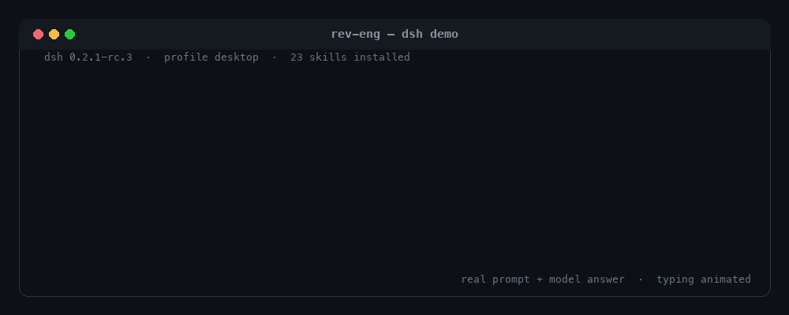

# dsh-rev-eng

One DeepSeek Harness plugin, two skill packs: **REA 6.8.0** for understanding
shipped apps, binaries, and bundles, and **BAMA 1.0.0** for taking a native
macOS app from idea to Dock. 23 skills total (21 BAMA + 1 REA + the `rev-eng`
router) ride with every profile that installs the bundle, and the optional REA
MCP server adds 229 analysis tools for sessions that need them.

Requires DeepSeek Harness `>=0.2.1-rc.3 <0.3.0-0` and Node.js >= 22.

<p align="center">
  
</p>

<p align="center"><sub>Real <code>/rev-eng</code> session: the prompt and the model answer are verbatim, only the typing is animated. <a href="docs/demo/session.txt">Transcript</a> · <a href="docs/demo/rev-eng.cast">asciinema recording</a></sub></p>

## What you get

### Reverse engineering with REA

REA explains how a shipped feature works from the artifact itself: native
binaries, Electron and JavaScript bundles, Android packages, firmware, GPU code
objects, .NET assemblies, packaged apps, and runtime captures. The skill routes
the target, gathers evidence, and reports what it can and cannot establish.

- `reverse-engineer-anything` is the workflow skill. It ships with seven
  reference guides covering target handling, evidence workflows, environments,
  runtime observation, Android, JavaScript, and native artifacts, plus a
  dsh-specific guide for the optional MCP mount.
- The optional REA MCP server exposes 229 tools to the session as
  `mcp__rea__*`, for interactive binary and application analysis.
- Analysis engines are optional and separate: Hopper, Ghidra, or IDA for native
  code, JADX plus a JDK for Android, Binwalk or Unblob for firmware on Linux.
  Static JavaScript and .NET inspection need no native engine.

### Native Mac apps with BAMA

BAMA is a pipeline of 21 skills that turns a screenshot, spec, or idea into a
Swift 6 / SwiftUI app: research, clone, brief, user stories, scaffold, code,
macOS integrations, design, performance, tests, and shipping. Specs for 12 small
apps (window snapper, launcher, clipboard history, screen recorder, and more)
ship as examples under `skills/app-brief/specs/`.

**Start here**

| The user wants to | Skill |
| --- | --- |
| Pick the next step in the pipeline | `bama` (type `/bama`) |
| Route between reverse engineering and Mac-app work | `rev-eng` (type `/rev-eng`) |
| Understand a shipped app or binary | `reverse-engineer-anything` |

**Build with BAMA, by stage**

| Stage | Skill | What it does |
| --- | --- | --- |
| Start | `bama` | Router: finds where you are and calls the right skill |
| Start | `app-brief` | Turns an idea (or an example spec) into a one-page brief |
| Start | `new-mac-app` | A working app from a template: Swift package, SwiftData, build script, snapshot mode, git |
| Plan | `research` | Market, users, features, design, and macOS API research |
| Plan | `clone` | Screenshots every screen of an app, with computer use or a browser |
| Plan | `user-stories` | A backlog with checkable acceptance criteria, in milestones |
| Code | `swift-swiftui` | Swift 6 concurrency, state, SwiftData, AppKit bridges, compiler errors |
| Code | `os-integrations` | Hotkeys, menu bar, floating panels, window control, screen capture, Shortcuts, URL schemes, permissions |
| Code | `performance` | Measure first, then fix: main thread, GPU compositing, images, Instruments |
| Code | `improve-architecture` | Finds hot spots and refactors one step per commit, with behavior proven unchanged |
| Code | `agent-cli` | Optional CLI and MCP server so agents and scripts can drive the app |
| Design | `ux-design` | Names, flow, where each feature opens, words, accessibility, before code |
| Design | `mac-design` | Liquid Glass, layout, toolbars, menus, keyboard, type, dark mode |
| Design | `design-system` | An accent color and one set of tokens with a rules page |
| Design | `layout-grid` | A 4 pt grid with checks that fail on misalignment |
| Design | `design-kit` | Your own parts, tokens, type, icon set, window chrome, and parts gallery |
| Design | `design-from-app` | Rebuilds the look of an app from screenshots, compared pixel by pixel |
| Design | `app-icon` | A Liquid Glass icon, checked in every look |
| Ship | `build-and-verify` | Build, install, snapshot every page in light and dark, look at them |
| Ship | `test-mac-app` | Swift Testing, an in-app self-test, a debug bridge an agent can drive |
| Ship | `improve-loop` | Works through the backlog one story per commit until a milestone is done |

`bama` is user-invoked: type `/bama` to start the pipeline. `rev-eng` is the
pack router and is model-invocable as well, so the agent can reach it on its
own.

## Requirements

- **DeepSeek Harness** `>=0.2.1-rc.3 <0.3.0-0`, desktop app or CLI. The
  Plugins UI checks the package's bundle patch and `engines.dsh` compatibility
  before installing.
- **Node.js >= 22** for the plugin itself.
- **macOS 26 or later and the Xcode 26 toolchain (Swift 6.2)** for BAMA builds.
  You never need to open the Xcode app, but `swift`, `xcodebuild`, `sips`, and
  `xcode-select` must be available. `xcode-select --install` covers the command
  line tools.
- **Computer use (optional)** for visual verification: BAMA's clone and verify
  steps use the harness computer-use capability when the session has it, and
  otherwise ask you for screenshots.
- **Node.js and npm** for REA. REA's MCP server and CLI run on Node 22 and
  later; its `setup` command additionally requires `^22.23.4`, `^24.22.1`, or
  `>=26.12.1`. Network access is needed for the first `npx rea-agents` run.
- **Optional REA engines:** Hopper, Ghidra, or IDA for native analysis; JADX
  plus a JDK for Android; Binwalk or Unblob for firmware on Linux. The skill
  never installs engines on its own: installing one is a separate, user-approved
  step.
- **Windows:** the skills install fine with `scripts/install.ps1`, and REA's
  analysis paths are not macOS-only, but BAMA builds native Mac apps and
  requires macOS. The shell installer needs Git Bash or a POSIX shell.

## Install

Two channels: install the bundle into a dsh profile, or copy the skill
directories into a skill root. Use one channel. Do not do both: the two copies
claim the same skill names, and the duplicate resolution depends on provider
order rather than on which copy you meant to use.

### Option 1: install the bundle (recommended)

The bundle carries its skills inside the package, so a single profile install
gives the whole pack to every session on that profile. dsh forwards the command
to pnpm, so a local path, an npm package, or a Git spec all work:

```sh
# from a checkout (installs as a link: dependency; the checkout must stay in place)
dsh plugin --profile web add /absolute/path/to/dsh-rev-eng

# from npm, once published
dsh plugin --profile web add dsh-rev-eng

# from git
dsh plugin --profile web add github:Stijnus/dsh-rev-eng
```

Install into an **existing app profile** (`web`, `tui`, or `headless`), not an
arbitrary new name: a profile created only by `dsh plugin add` contains the base
runtime but no app bundle, so it cannot boot. Confirm the layer composed, then
boot the profile:

```sh
dsh --profile web --dump-config   # contains "# == dsh-rev-eng" and "- id: rev-eng-skills"
dsh --profile web
```

**Desktop app.** The `desktop` profile is managed exclusively by the app, and
ordinary CLI boot or `--dump-config` of it is refused. Install from the app's
**Plugins → Add plugin** dialog instead: it accepts a package name with an
optional version, a Git address, a tarball, or the absolute path of a local
checkout. It inspects the spec first (package manifest, bundle patch, and
`engines.dsh` / peer compatibility), then runs the profile's package install and
offers **Enable now**. This is the same inspect → package-install → enable
operation the CLI performs, scoped to the running desktop profile. Uninstall
from the bundle's page there. Do not run `dsh plugin --profile desktop` from a
terminal: the desktop profile belongs to the app, and the Plugins page is the
supported install path.

A local-path install is saved as a `link:` dependency, so the checkout must stay
where it is. For distribution to other machines, publish the package (or use a
tarball or Git spec) and install that spec through the CLI or the Plugins page.

### Option 2: drop-in skill copy (no bundle)

For a quick no-install trial, copy the packaged skills into a skill root that
dsh already watches. This works across profiles and needs no package install:

```sh
# macOS / Linux / Git Bash: into ~/.dsh/skills (DSH_HOME is honored)
bash scripts/install.sh

# Windows PowerShell: same target
powershell -ExecutionPolicy Bypass -File scripts\install.ps1
```

Flags:

```sh
bash scripts/install.sh --list                 # shipped skill names + the target roots
bash scripts/install.sh --project ~/code/my-app # <project>/.dsh/skills, rank 100
bash scripts/install.sh --user-agents          # $DSH_AGENTS_HOME/skills (~/.agents/skills), rank 500
bash scripts/install.sh --uninstall            # remove this pack's skills from the selected target
```

`--uninstall` removes only the pack's known skill directories; everything else
in the directory is left untouched. `--project` requires the directory to
exist. The PowerShell script takes `-Project`, `-UserAgents`, `-List`, and
`-Uninstall`.

The drop-in copy is picked up by the skill-root watcher without an app restart,
and a new session is the cleanest way to confirm it. What the installer does: it
copies each `skills/<name>/` directory as-is (references, scripts, templates,
and example specs included), preserves the scripts' executable bits, replaces a
previous copy of the same skill directory on a re-run, and prints the target and
the next steps.

There is no one-shot bundle trial. Booting with `--patch cordis.patch.yml`
composes the layer but the plugin cannot import until the package is installed
into the profile (`Cannot find package 'dsh-rev-eng'`), so the harness starts
without the skills. Use the drop-in copy for a no-install trial.

## Optional: REA MCP server

Installing this pack gives the agent REA's workflow instructions, not REA's
tools. The MCP server is an explicit opt-in for reverse-engineering sessions.
REA 6.8.0 officially supports dsh, so REA can write the registration itself; the
package also ships an overlay for environments where that setup flow should not
run.

### Official registration (REA writes the row)

Review the read-only plan, then apply it:

```sh
npx -y rea-agents@6.8.0 setup --client dsh --skill=false --dry-run --json
npx -y rea-agents@6.8.0 setup --client dsh --skill=false --yes
```

Setup writes one row with id `rea-mcp`, serverName `rea`, and the
`@deepseek-ai/dsh-mcp-client` module into `$DSH_HOME/cordis.patch.yml`. That is
the **home patch**: it applies to every profile on the machine, the desktop app
included. Setup preserves unrelated patches and comments and replaces only its
own launcher fields. After it runs, **restart dsh** (quit and reopen the app, or
exit and relaunch the CLI profile), then verify that `mcp__rea__*` tools appear
in a session.

`--skill=false` is the correct choice when this pack is installed. The pack's
provider exposes the adapted REA workflow skill at rank 400; the canonical copy
setup would install lands in `~/.agents/skills` (`$DSH_AGENTS_HOME/skills` when
set) at rank 500, where the same skill name is shadowed, so installing it would
only add a redundant duplicate.
(The pack's provider wins on rank. Without this pack, `rea setup --skill` is the
canonical install.)

Inspect the registration with `rea doctor --client dsh --json`; a healthy,
aligned result appears once the row exists. `rea uninstall` removes the REA row
and any REA-installed skill.

**Node version gate.** REA 6.8.0's `setup` hard-gates Node: it accepts
`^22.23.4`, `^24.22.1`, or `>=26.12.1`, and refuses other releases. The MCP
server itself runs fine on the refused versions, so only `setup` is blocked.
Options when the plan reports the gate:

- Upgrade Node to an accepted release and rerun setup.
- Run the same REA setup under an accepted runtime, pointing
  `npx -y node@24.22.1` at the installed `rea-agents/scripts/rea.mjs` entry
  point.
- Skip setup and use the pack overlay below, which needs no `rea setup` and has
  no Node gate.

### Pack overlay (no setup)

`patches/rea-mcp.yml` is one insert row with the same id and serverName, an
`npx -y rea-agents@6.8.0 mcp` launcher, and `toolCallTimeoutMs: 600000`.
One-shot use, for a single run of a profile:

```sh
dsh --profile web --patch /absolute/path/to/dsh-rev-eng/patches/rea-mcp.yml
```

For permanent use, merge the single insert row into a profile patch
(`$DSH_HOME/profiles/<name>/cordis.patch.yml`) or into the home patch
(`$DSH_HOME/cordis.patch.yml`), then restart dsh. Merge, do not replace: the
file may hold unrelated patches.

**Never enable the official registration and the overlay together.** Both use
`serverName: rea`, and dsh refuses two MCP entries with the same server name
even when they sit in different layers. The result is a duplicate-server-name
load failure with missing tools. Use one, not both.

### What to expect from the mount

- Tools appear to the model as `mcp__rea__<rawName>`, for example
  `mcp__rea__open_binary`. The guides use REA's raw names; add the prefix when
  calling.
- **Timeout:** dsh sets one `toolCallTimeoutMs` per row, default 60000 ms, which
  is far too short for real analyses. The overlay sets 600000 ms; the official
  row has no timeout by default, so add `toolCallTimeoutMs: 600000` under its
  `config` (REA keeps caller-owned config fields when it later rewrites its own
  row). REA's own static-analysis budget defaults to 300000 ms, and a cold
  native provider import can take longer.
- **Context cost:** 229 tools enter the model's tool list while the row is
  active. Enable the mount for reverse-engineering sessions rather than as a
  permanent global default when context budget matters.
- **Connection behavior:** a row that cannot start does not abort the harness.
  The session starts without the REA tools and the client logs
  `mcp-client(rea)` lines. The first `npx` start also pays a package download
  (seconds, not minutes) when the npm cache is cold; a warm cache connects in
  under a second.

## Use it

Prompts pick the pack through the `rev-eng` router, then the skill does the
work. A few examples:

| You say | What loads |
| --- | --- |
| "Explain how the Notes app renders search results, down to the binary, and show me the evidence." | `rev-eng` → `reverse-engineer-anything` (native analysis; an engine is needed) |
| "Inspect this Electron app's `app.asar`, list its IPC channels, and compare them with the previous release." | `rev-eng` → `reverse-engineer-anything` (static JavaScript, no native engine) |
| "Rebuild the look of this app as a native Mac app." | `rev-eng` → `reverse-engineer-anything` for evidence, then BAMA's `clone` |
| "Write a one-page brief for a menu bar clipboard manager." | `bama` → `app-brief` |
| "Build the window-snapper spec, then snapshot every screen and run the tests." | `bama` → `app-brief` → `user-stories` → `new-mac-app` → `build-and-verify` |

You can skip the router and ask for a skill by name, or type `/bama` or
`/rev-eng` to start one directly. One skill loads at a time; each skill tells
the agent which skill comes next.

## How it works

- The package is a dsh **bundle**: `package.json` points `dsh.bundle.patch` at
  [`cordis.patch.yml`](cordis.patch.yml), which inserts the `rev-eng-skills` row
  named `dsh-rev-eng` into the profile's composition.
- That row mounts the plugin in [`src/index.js`](src/index.js), which registers
  a **skill provider** over the packaged `skills/` directory. The provider scans
  the directory on every `list()`, reads each `SKILL.md` with the flat
  frontmatter parser in [`src/frontmatter.js`](src/frontmatter.js), and serves
  the bodies on demand with the skill directory as the resource base.
- The provider runs at **rank 400 with source `bundled`**. That beats a copy in
  `~/.agents/skills` (rank 500), while project skill roots (ranks 100 to 200)
  and configured custom directories (rank 300) still win. A drop-in copy in
  `~/.dsh/skills` is also rank 400, which is why the two install channels should
  not be combined.
- A provider is used instead of a `customSkillDirs` entry because the profile's
  composition base URL is the profile directory, not this package. Packaged
  skills have to ride with plugin code that resolves its own paths from
  `import.meta.url`, so the bundle works wherever the package is installed.
- The `rev-eng` router is packaged as a normal skill. `bama` keeps
  `disable-model-invocation: true`, so it is user-invoked with `/bama`; the
  other 22 skills are model-invocable.
- Live edits: the packaged provider rescans `skills/` on every list but installs
  no file watcher, and the skill registry caches catalog snapshots. Editing an
  installed skill's body is visible on its next `skill` call; adding a new skill
  directory to an already-installed package needs a new session. The drop-in
  copy path uses dsh's watched local provider, so additions there appear without
  a restart.

## Differences from upstream

The skills are the upstream workflows with dsh's tool names, path idioms, and
client setup; technical substance, skill names, references, scripts, templates,
and example specs are preserved. REA's client-specific connection guide was
rewritten for dsh and a new dsh harness guide was added. BAMA's nested layout
was flattened, cross-skill links were re-pointed, `specs/` moved under the
`app-brief` skill, and client-specific metadata directories were dropped.

The mapping table, the REA official-client handling, and the per-skill change
log are in [docs/adaptation.md](docs/adaptation.md). Detailed per-file logs are
in the repository's `notes/bama-adaptations.md` and `notes/rea-adaptations.md`.

## Troubleshooting

### Skills are not listed

- Install the bundle into the profile you actually started, then start a **new
  session** on that profile. A session that started before the install does not
  pick up the bundle's catalog.
- A profile created by `dsh plugin add` alone has no app bundle to launch.
  Install into a shipped app profile (`web`, `tui`, `headless`) or into the
  desktop profile through the Plugins page.
- Check `dsh --profile <name> --dump-config` for the `# == dsh-rev-eng` layer.
  If the layer is missing, the package did not install into that profile.
- If you installed both the bundle and the drop-in copy, duplicate skill names
  resolve by provider order. Remove one channel.
- If you edited or added skill directories inside an installed package, restart
  the session: the packaged provider does not watch the filesystem.

### REA MCP tools are missing

- Confirm a row exists: the home patch `$DSH_HOME/cordis.patch.yml` after
  official setup, a profile patch after a permanent overlay merge, or the
  `--patch` flag for a one-shot run.
- Restart dsh after any configuration change: the home and profile patch layers
  are composed at boot. A session that started before the row loaded never
  gains the tools.
- Run `rea doctor --client dsh --json` to inspect the registration from REA's
  side.
- Check for duplicate `serverName: rea` rows from enabling both the official
  setup and the overlay. Remove one row and restart.
- Make sure `npx` is on the harness's PATH: the row launches `npx` as a child
  process and inherits PATH but not credential-named or `DSH_*` variables.
  A cold npm cache makes the first connection slower; retry once before
  diagnosing.
- If calls fail while tools exist, the row probably hit `toolCallTimeoutMs`
  (default 60000 ms). Raise it, and note that a client-side timeout does not
  prove REA finished or released its analysis session.
- Approval prompts are the harness's, not REA's: the session's permission
  preset decides what is allowed. An unattended run reports the blocked
  operation instead of retrying it.
- When the row cannot start, look for `mcp-client(rea)` lines in the harness
  log: initial connection and discovery failures, reconnect attempts, and the
  final `giving up ... tools unregistered` line appear there. The fastest
  independent check is to launch the same profile from a terminal.

### BAMA builds fail

- Verify the toolchain: `xcode-select -p` prints a developer directory, and
  `swift --version` reports Swift 6.2 or later. `xcode-select --install`
  installs the command line tools when they are missing.
- BAMA targets macOS 26 and later with the Xcode 26 toolchain. An older
  toolchain fails on the generated package before app code runs.
- Visual checks need the harness computer-use capability when the session has
  it; otherwise the skills fall back to asking you for screenshots. Say so
  explicitly when you cannot provide them.
- Windows: the skills can be installed, but the BAMA skills build native Mac
  apps and do not run on Windows.

## Uninstall

- **Bundle:** uninstall `dsh-rev-eng` from the bundle's page in the Plugins UI,
  or run `dsh plugin --profile <name> remove dsh-rev-eng` for a CLI profile.
  On the desktop profile, use the Plugins page.
- **Drop-in copy:** `bash scripts/install.sh --uninstall` (add `--project <dir>`
  or `--user-agents` to pick the target you installed into). The PowerShell
  script accepts `-Uninstall` with the same target flags.
- **REA MCP:** after official setup, run `rea uninstall` to remove the row (and
  any REA-installed skill). An overlay row merged by hand is not REA's to
  remove: delete that insert from the patch file. A one-shot `--patch` run
  writes nothing permanent.
- No configuration is shared between the bundle and the drop-in copy, so
  uninstalling one does not affect the other.

## Provenance and license

- [PROVENANCE.md](PROVENANCE.md) records the upstream repositories, pinned
  commits, licenses, and the refresh procedure.
- [LICENSE](LICENSE) is MIT: this package's adaptation plus the preserved
  upstream notices for REA (Copyright (c) 2026 morluto) and BAMA (Copyright (c)
  2026 Dave Ebbelaar).
- [CHANGELOG.md](CHANGELOG.md) lists the 0.1.0 contents.

## Responsible use

REA is a dual-use analysis toolkit. Target execution is real: runtime tools
attach to processes and can change files, memory, and network state regardless
of the harness sandbox around the client. Analyze only targets you are allowed
to analyze, and keep the scope explicit. Read the upstream
[disclaimer](docs/rea-disclaimer.md) before using REA.

## Development

```sh
npm test                    # syntax checks + plugin unit tests
npm run lint:skills         # validate every SKILL.md, link, and frontmatter rule
./verification/verify.sh    # acceptance gate in an isolated DSH_HOME
./verification/verify.sh --full   # plus a live boot and REA MCP connection check
python3 scripts/make-demo-gif.py  # rebuild the README demo GIF and asciinema cast
```

The gate never touches your real dsh home or desktop profile.
[docs/adaptation.md](docs/adaptation.md) explains how to re-sync from upstream,
and [verification/REPORT.md](verification/REPORT.md) records the exact tested
install story and known limits.
